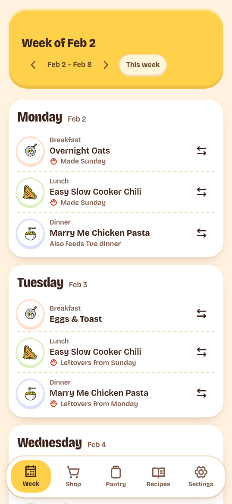
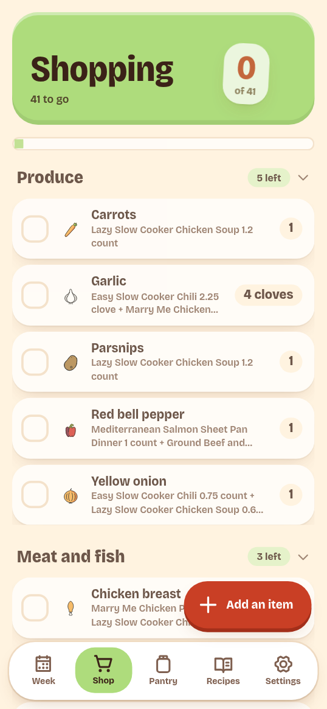
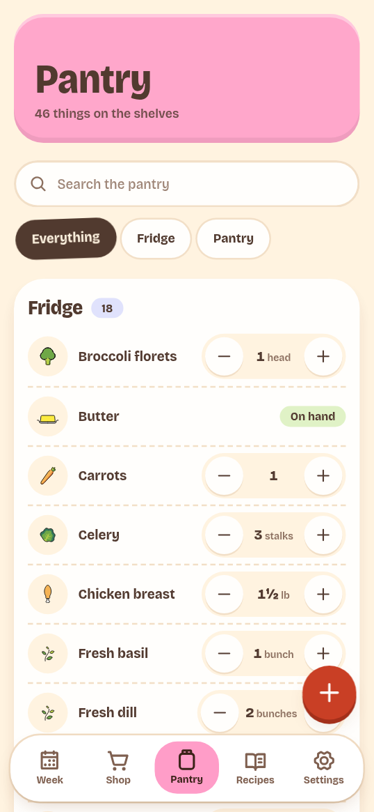
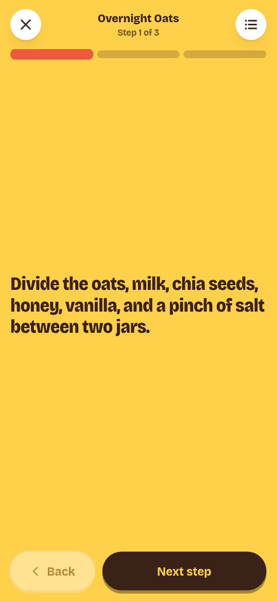

  

<h1 align="center">PantryPal</h1>

  Plan meals. Track food. Shop for what you need.

  
  
  

  <a href="#about">About</a> ·
  <a href="#screenshots">Screenshots</a> ·
  <a href="#key-features">Features</a> ·
  <a href="#documentation">Documentation</a> ·
  <a href="#contributing">Contributing</a> ·
  <a href="#license--credits">License &amp; credits</a>

## About

PantryPal is a self-hosted app for household meal planning. Keep your recipes,
food stock, meal plans, and shopping lists in one place. Use the web app or
connect an AI assistant through MCP. Your data stays on your server.

## Screenshots

<table>
  <tr>
    <th>Week</th>
    <th>Shop</th>
  </tr>
  <tr>
    <td></td>
    <td></td>
  </tr>
  <tr>
    <th>Pantry</th>
    <th>Cook mode</th>
  </tr>
  <tr>
    <td></td>
    <td></td>
  </tr>
</table>

## Key features

- **Plan meals:** arrange meals and leftovers across the week.
- **Track food:** record amounts, storage locations, and expiry dates.
- **Manage recipes:** scale ingredients to the number of servings.
- **Shop with a list:** build a list from your plan and the food you have.
- **Cook step by step:** follow a recipe and update stock when you finish.
- **Connect an AI assistant:** use MCP to manage recipes, plans, and stock.

## Documentation

[Read the documentation](docs/README.md) for setup, guides, and reference.

## Contributing

Read the [contribution guide](docs/develop/contributing.md) to report a bug,
suggest a change, or submit a pull request.

## License & credits

PantryPal uses the [MIT license](LICENSE).

- Emoji art: [OpenMoji](https://openmoji.org),
  [CC BY-SA 4.0](web/public/openmoji/LICENSE.txt).
- UI icons: [Phosphor](https://phosphoricons.com),
  [MIT](https://github.com/phosphor-icons/react/blob/master/LICENSE).
