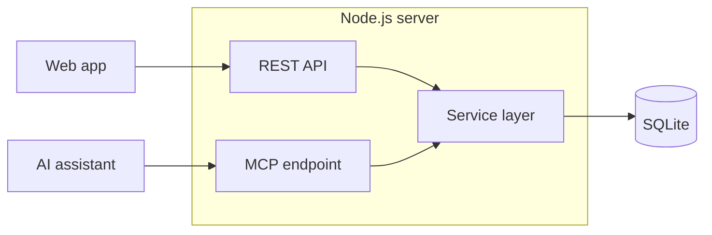

# Architecture

## Code map

| Path | Purpose |
| --- | --- |
| `web/src/` | React web app, routes, screens, and shared UI |
| `src/api/` | Hono routes, OpenAPI, and static file serving |
| `src/auth/` | Accounts, passwords, bearer tokens, sessions, and origin checks |
| `src/mcp/` | MCP transport and tool handlers |
| `src/services/` | Food calculations and data changes |
| `src/schemas/` | Zod input and output schemas |
| `src/db/schema.ts` | Database tables |
| `drizzle/` | Database migrations |
| `nutrition/` | Bundled USDA food data, built by `pnpm nutrition:data` |
| `src/seed/` | JSON import loader; every seed ingredient declares `fdcId` or `custom` |
| `src/cli.ts` | Household, token, migration, and import commands |

Keep food calculations in services. REST routes and MCP tools call the same
services. Clients must not duplicate stock or serving calculations.

## Web UI conventions

Use the shared components in `web/src/ui/`. Do not write a second copy of one.
`SegmentedControl` is the only chip row. `ConfirmDialog` is the only destructive
confirmation. `Button` has these variants:

| Variant | Use |
| --- | --- |
| `primary` | The one affirmative action of a screen. |
| `secondary` | A normal action. |
| `ghost` | A low-weight action. |
| `danger` | The confirm inside `ConfirmDialog`. |
| `dangerGhost` | A trigger for a destructive action. |

- Destructive actions: confirm with `ConfirmDialog`, whose confirm button is
  `danger`. Never use `primary` for a delete, remove, clear, or a permanent
  status change. Mark the matching chip with `danger: true` in
  `SegmentedControl`.
- Sheets: `Sheet` is a bottom sheet on phones and a centered 560 px dialog from
  700 px. The `footer` holds the secondary action first and the primary last.
  Keep destructive actions out of the footer.
- Sheet panels shrink within the viewport; keep long content in the scrolling
  body, and give flex/grid children `min-width: 0` so narrow sheets do not clip
  controls horizontally.
- Add actions: one entry point per state. An empty screen carries the primary in
  `EmptyState`. A filled screen carries one add button in the header or in a
  toolbar row above the list. Do not stack a `Fab` with another add action.
- Toolbars: navigation and list controls (week pagination, list switcher) get
  their own row below `PageHeader`. Do not put them in the header `sub`; they
  are clipped at 320 px there.
- Action rows: one primary and one secondary at most. Move further actions into
  an icon button or a menu.

## Data rules

- Each account owns one household. Household data carries a household ID; every query filters by it.
- Stock movements record changes. Pantry rows hold the current stock.
- Planned cooks determine stock commitments. There is no separate reservation table.
- One cook can feed several meal slots. Later slots represent leftovers.
- A recipe keeps separate ingredient and step records. A line can list
  alternative ingredients. Nutrition, stock, shopping, and dietary checks use
  only the main ingredient.
- Services never create an ingredient from a free-text name. A write that names
  an unknown ingredient fails with `unprocessable` and suggestions. An
  ingredient is created only through a USDA food (`fdcId`) or as a custom
  ingredient. Name lint runs on every create and rename.
- A custom ingredient has no USDA food and can carry `needsReview`. Only a
  browser session counts as a web request; every other request counts as API.
- Quantities can be unknown. Do not treat an unknown amount as zero.
- Size units (`small`, `medium`, `large`, `extra-large`, `jumbo`) are count units. An ingredient can set `defaultPortion` to a size that a bare count means.
- One converter (`convert` in `src/services/units.ts`) serves nutrition, the pantry, cooking, shopping demand, and the review list. It uses the built-in unit tables first. Then it goes through grams with the ingredient's measures: the linked USDA food's portions, overridden by the household's `ingredient_measure` rows. It never guesses across families, so a volume with no density does not convert.
- Each ingredient has one stock unit (`stock_unit`). Pantry amounts, par levels, and shopping quantities are stored in it. A write in another unit is converted first. A unit that the ingredient does not accept is `unprocessable` with `details.unresolvedUnits`.
- USDA measures are derived at read time and are never copied into the database. A re-link changes them.

## Schema changes

1. Change `src/db/schema.ts`.
2. Run `pnpm db:generate`.
3. Review and include the generated migration files.
4. Check the migration against a copy of an existing database.

The server and CLI apply pending migrations when they open the database.
A code rollback does not undo a migration. See [Updates](../host/updates.md).
