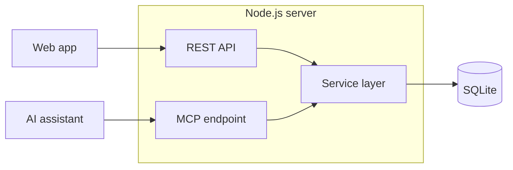

# Architecture

## Code map

| Path | Purpose |
| --- | --- |
| `web/src/` | React web app, routes, screens, and shared UI |
| `src/api/` | Hono routes, OpenAPI, and static file serving |
| `src/auth/` | Bearer tokens, browser sessions, and origin checks |
| `src/mcp/` | MCP transport and tool handlers |
| `src/services/` | Food calculations and data changes |
| `src/schemas/` | Zod input and output schemas |
| `src/db/schema.ts` | Database tables |
| `drizzle/` | Database migrations |
| `src/seed/` | JSON import loader |
| `src/cli.ts` | Household, token, migration, and import commands |

Keep food calculations in services. REST routes and MCP tools call the same
services. Clients must not duplicate stock or serving calculations.

## Data rules

- Each instance supports one household. Household data carries a household ID.
- Stock movements record changes. Pantry rows hold the current stock.
- Planned cooks determine stock commitments. There is no separate reservation table.
- One cook can feed several meal slots. Later slots represent leftovers.
- A recipe keeps separate ingredient and step records.
- Quantities can be unknown. Do not treat an unknown amount as zero.
- Use defined unit conversions. Do not guess a weight from a volume.

## Schema changes

1. Change `src/db/schema.ts`.
2. Run `pnpm db:generate`.
3. Review and include the generated migration files.
4. Check the migration against a copy of an existing database.

The server and CLI apply pending migrations when they open the database.
A code rollback does not undo a migration. See [Updates](../host/updates.md).
