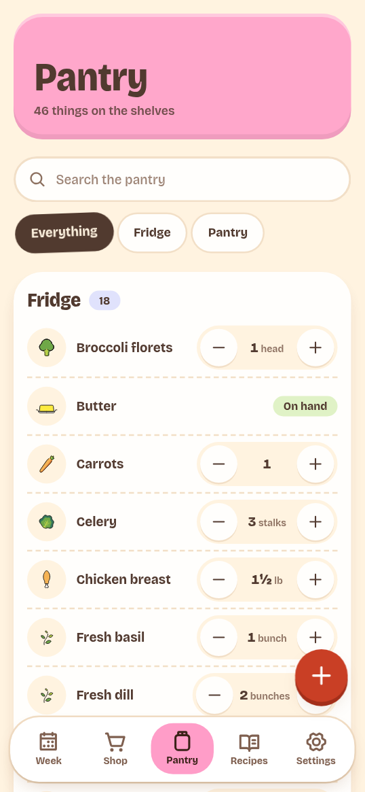
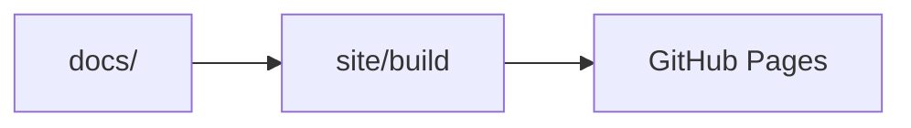

# Documentation

PantryPal keeps one copy of the documentation in `docs/`. Docusaurus builds the
documentation site from these files. Do not copy pages into `site/` or another
directory.

## Requirements

- Node.js 22 or later. CI uses Node.js 24.
- pnpm, as pinned by `packageManager` in `package.json`.

Run commands from the repository root.

## Local commands

| Command | Result |
| --- | --- |
| `pnpm docs:dev` | Start the development server. Changes reload. |
| `pnpm docs:build` | Build the production site in `site/build`. |
| `pnpm docs:serve` | Serve the production build. |

The development server uses `http://localhost:3000/pantry-pal/`. The base path
is part of the site configuration.

Run `pnpm install` before the first command.

## Files

| Path | Purpose |
| --- | --- |
| `docs/` | Markdown source and images. This is the only source copy. |
| `docs/README.md` | Home page. Its slug is `/`. |
| `docs/images/` | Screenshots and diagrams that the guides use. |
| `site/` | Docusaurus configuration, theme, and build output. |
| `site/sidebars.js` | Sidebar groups and page order. |

`site/build` holds generated files. Do not commit it.

## Add a page

1. Create or edit a `.md` file in `docs/`. Put the file in the directory for its
   audience: `start/`, `use/`, `connect/`, `host/`, `develop/`, or `reference/`.
2. Add the document ID to `site/sidebars.js`. The ID is the file path below
   `docs/` without `.md`, for example `develop/checks`.
3. Run `pnpm docs:dev` and open the page.

Docusaurus reads Markdown files as MDX. Escape a literal `<` or `{` in normal
text. For example, write `\<name>` to show `<name>`.

## Links and images

- Link to another page with a relative path and `.md`. Docusaurus changes the
  link for the published site.

  ```md
  [Tests and checks](checks.md)
  [Access and security](../host/security.md)
  ```

- Link to code, configuration, or other files outside `docs/` with the GitHub
  URL. The published site has no copy of the repository, and relative links
  cannot leave `docs/`.

  ```md
  [sidebars.js](https://github.com/dev-arekusandoru/pantry-pal/blob/main/site/sidebars.js)
  ```

  Use [`tree`](https://github.com/dev-arekusandoru/pantry-pal/tree/main/site) in
  place of `blob` for a directory.

- Put images in `docs/images/` and use a relative path.

  ```md
  
  ```

## Diagrams

Docusaurus renders Mermaid diagrams. Use a `mermaid` code fence.

````md

````

Keep each diagram small. Put exact values in a table or a list.

## Production site

The site configuration uses these settings:

| Setting | Value |
| --- | --- |
| URL | `https://dev-arekusandoru.github.io` |
| Base path | `/pantry-pal/` |
| Published address | `https://dev-arekusandoru.github.io/pantry-pal/` |

Do not add the base path to page links. Docusaurus adds it. There is no custom
domain. Do not add a `CNAME` file.

## Builds and deployments

The [Docs workflow](https://github.com/dev-arekusandoru/pantry-pal/blob/main/.github/workflows/docs.yml)
builds the site and deploys it to GitHub Pages.

| Event | Action |
| --- | --- |
| A pull request changes `docs/`, `site/`, `package.json`, `pnpm-lock.yaml`, `pnpm-workspace.yaml`, or the workflow | Build only. No deploy. |
| A push to `main` changes one of these paths | Build and deploy. |
| A manual run on `main` | Build and deploy. |

A push to `main` that changes only other paths does not run the workflow. A
manual run starts from the Actions tab: select **Docs**, then **Run workflow**,
and select `main`.

The build job installs dependencies with `pnpm install --frozen-lockfile`,
runs `pnpm docs:build`, and uploads `site/build` as the Pages
artifact. The deploy job uses `actions/deploy-pages` and the `github-pages`
environment. The build job can read the repository contents. The deploy job has
the `pages: write` and `id-token: write` permissions. One Pages deployment runs
at a time, and a running deployment is not cancelled.

### Repository setup

Set the Pages source one time:

1. On GitHub, open the repository **Settings**.
2. Select **Pages**.
3. Under **Build and deployment**, set **Source** to **GitHub Actions**.

The `github-pages` environment shows the deployment URL after the first run.
Only the workflow deploys the site. Do not deploy from a local branch.
