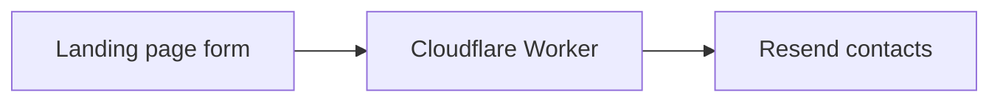

# Waitlist

The landing page waitlist saves each email address as a contact in
[Resend](https://resend.com). A small Cloudflare Worker sits between the page and
Resend. The Worker holds the Resend API key, so the key never reaches the browser.
The Rakumi app does not use the waitlist. Self-hosters do not need it.



The Worker does these tasks:

- Accepts a `POST` only from the origins in `ALLOWED_ORIGINS`.
- Discards a sign-up that fills the hidden `website` field, and still answers `200`.
- Lowercases the address and adds it to Resend. A repeat sign-up answers `200`.
- Sends a welcome email from `WELCOME_FROM` for each new address. A failed email is logged and does not fail the sign-up.
- Answers `400` for a bad address, `413` for a body over 2 KB, and `502` if Resend fails.

The origin check keeps other websites out of a browser. It is not authentication.
To limit abuse, add a Cloudflare rate limiting rule for the Worker.

## Set up

1. In Resend, open **API Keys**. Create a key with **Full access**.
2. In Resend, create a segment and copy its ID.
3. In `landing/worker/wrangler.toml`, set `ALLOWED_ORIGINS` to the origin of the
   landing page, for example `https://example.com`. Use a comma between
   several origins. Set `RESEND_SEGMENT_ID` to the segment ID. Set `WELCOME_FROM`
   to an address on a domain you verified in Resend (**Domains**).
4. From `landing/worker/`, sign in and deploy:

   ```sh
   pnpm dlx wrangler login
   pnpm dlx wrangler secret put RESEND_API_KEY
   pnpm dlx wrangler deploy
   ```

5. Copy the Worker URL that `deploy` prints. Set `waitlistEndpoint` in
   `landing/src/config.ts` to it, and build the landing page.

Until you set `waitlistEndpoint`, the form shows "The waitlist isn't open yet."

## Manage the list

Use the Resend dashboard: **Contacts** lists the addresses, and **Broadcasts**
emails them. Resend adds an unsubscribe link to each broadcast and keeps the
unsubscribe state.

## Invite people at launch

In Resend, open **Broadcasts**. Create a broadcast, pick the Rakumi segment as
the audience, and send it. The free plan limits daily sends, so check the limit
for the size of the list first.

## Privacy

Resend stores the addresses. Name Resend in the privacy policy. The Worker stores
nothing.
