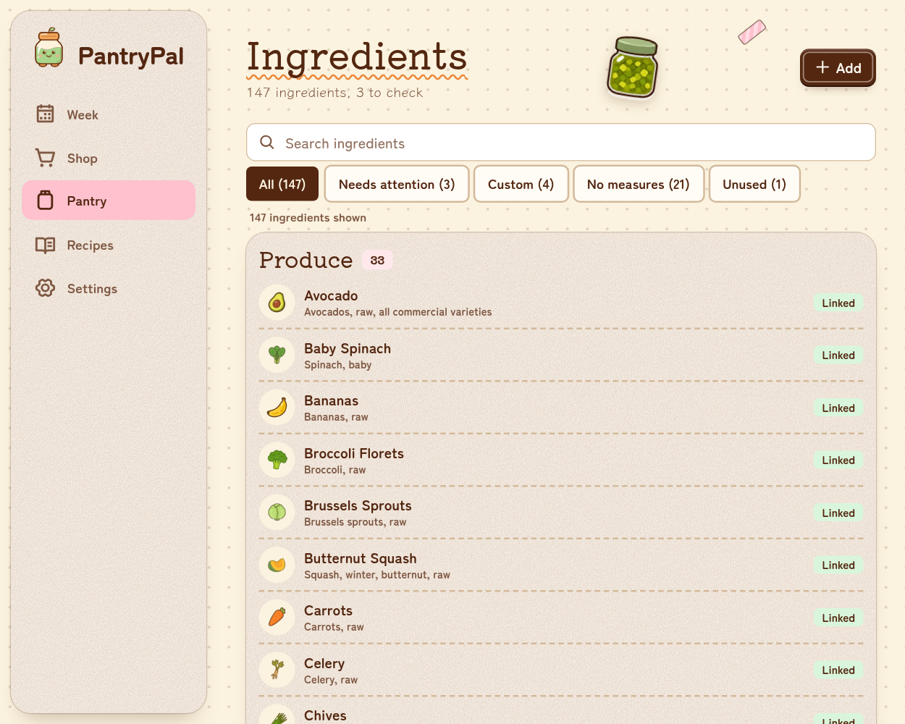
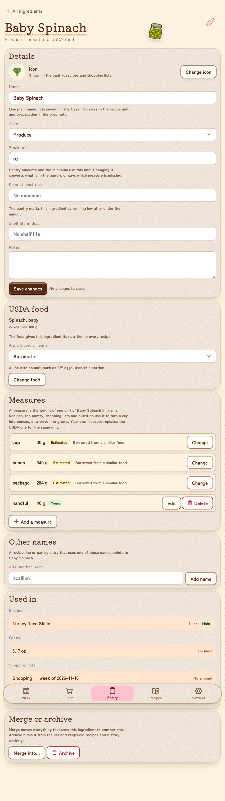
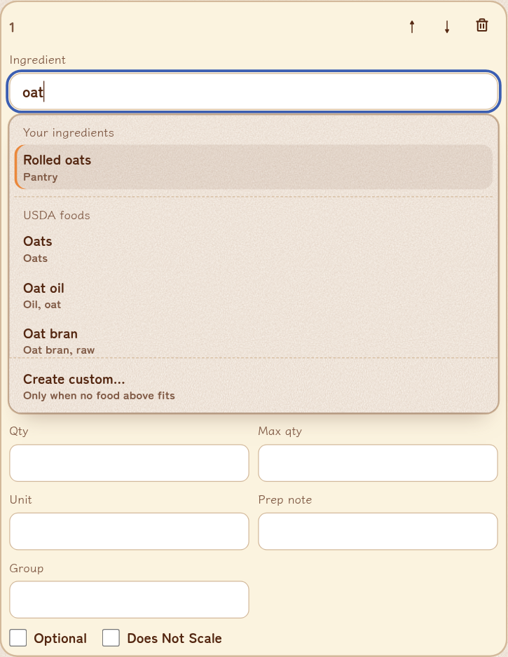

# Ingredients

Every ingredient in PantryPal is one of two kinds:

- **Linked**: it uses a food from the bundled USDA database. It has nutrition
  data.
- **Custom**: it has no USDA food. It has no nutrition data. Use a custom
  ingredient only when no USDA food fits.

A typed name never creates an ingredient by itself. You choose an ingredient
from a list, or you add one on purpose. This keeps names clean, so "Milk or
water" and "2 eggs, beaten" do not become ingredients.

Each ingredient has one page. It shows everything about the ingredient in one
place: its name, icon, aisle, stock unit, USDA food, measures, other names, and where it is used.
All ingredients are in the [ingredient list](#the-ingredient-list).

## The ingredient list

The **Ingredients** page lists every ingredient, grouped by aisle. Open it from
either place:

- **Ingredients** in the Pantry header.
- **Settings** > **Ingredients** > **Open ingredients**.

Its address is `/ingredients`. The Pantry tab stays highlighted while you view
it.

Each row shows the icon, the name, and the linked USDA food. Pills show the
state: **Linked** or **Custom**, **Needs attention**, **No measures**, and
**Unused**. Tap a row to open the ingredient page.

Use **Search ingredients** to filter by name or other name. The chips filter the
list. Each chip shows its count.

| Chip | Shows |
| --- | --- |
| **All** | Every ingredient that is not archived. |
| **Needs attention** | Ingredients that need a look. See [Needs attention](#needs-attention). |
| **Custom** | Ingredients with no USDA food. |
| **No measures** | Ingredients with no [measure](units.md) at all: no USDA serving size and none of your own. Cups, spoons, and counts cannot turn into grams for them. Add a measure on the ingredient page. |
| **Unused** | Ingredients that no recipe, pantry row, open shopping list, or dietary rule uses. |

The chip is part of the address, for example `/ingredients?filter=attention`.
The old address `/ingredients/review` opens **Needs attention**.

Tap **Add** to add an ingredient. The sheet has the same search box as the rest
of the app. See [Choose an ingredient](#choose-an-ingredient). After you choose
or create one, its page opens.

## The ingredient page

Every change on the page goes through the same API calls as the rest of the app.

| Section | What you can do |
| --- | --- |
| **Details** | Change the **Icon** (**Change icon** opens the icon sheet; see [Ingredient icons](icons.md)), **Name**, **Aisle**, **Stock unit**, **Keep at least** (the pantry minimum, in the stock unit), **Shelf life in days**, and **Notes**. Tap **Save changes**. See [Units and measures](units.md#the-stock-unit). |
| **USDA food** | See the linked food. **Change food** or **Link to a food** searches the USDA foods. For a food with portions, **A plain count means** sets the portion that an amount without a unit uses. |
| **Measures** | See the weight of one unit in grams, with a **USDA**, **Estimated**, or **Yours** badge. Add, change, and delete your own measures. **Reset to USDA** restores a USDA weight. See [The Measures section](units.md#the-measures-section). |
| **Other names** | Add or remove names that point to this ingredient, such as "scallion". Tap `×` on a name to remove it. |
| **Used in** | Recipes (with the number of lines, and **Main** or **Alternative**), the pantry amount, items on shopping lists that are not done, and dietary rules. Recipes, the pantry, and shopping lists are links. |
| **Merge or archive** | **Merge into…** moves everything to another ingredient. **Archive** hides the ingredient from the list. |

A name error shows under **Name**, for example when the name breaks the
[naming rules](#naming-rules) or another ingredient has the name. The focus
moves to the box.

**Archive** asks first. Recipes that use the ingredient keep working.

### Open the page from other screens

| Screen | How |
| --- | --- |
| Pantry | Tap the row to open the amount sheet, then tap **Ingredient page**. |
| Recipe | Tap an ingredient name in the ingredient list. Names of alternatives are links too. |
| Recipe nutrition | Tap an ingredient name in **Show ingredient breakdown**. |
| Shopping list | Tap the info button at the end of a row. The rest of the row still checks the item off. |
| Sticker book | Select a collected sticker, then tap **Open** and the name. |

## Choose an ingredient

The same search box appears wherever you name an ingredient:

- **Ingredient** and **Alternative ingredient** on a recipe line. See
  [Create and edit recipes](recipe-editor.md).
- **What is it?** in the pantry **Add** sheet. See [Pantry](pantry.md).
- **Main ingredient**, **Alternative**, and **Merge into** on the
  [ingredient page](#needs-attention).
- **Add** on the [ingredient list](#the-ingredient-list).

Type a few letters. The list has up to three parts:

| Part | Content |
| --- | --- |
| **Your ingredients** | Ingredients you already have. A **Custom** pill marks one with no USDA food. |
| **USDA foods** | Foods from the bundled USDA data. Each shows a short name and the full USDA description. |
| **Create custom…** | The last option. It stays in view at the bottom of the list. |

Pick an item with a tap or click. With a keyboard, press the Down and Up arrow
keys to move, **Enter** to choose, and **Esc** to close the list. Inside a
sheet, **Esc** closes the sheet. A screen
reader reads the box as a combobox and announces the count of matches.

After you choose, the box shows the ingredient with a **Change** button.

## Add a USDA food as an ingredient

1. Type the food, for example `banana`.
2. Under **USDA foods**, choose the best match. Read the description under the
   name. For example, "Bananas, raw".
3. In **Add this food as an ingredient**, check **Ingredient name**. The box
   starts with a short name made from the USDA description. You can change it.
4. Choose a **Shopping aisle**. The default is **Other**.
5. Tap **Add ingredient**.

If your household already has an ingredient for that food, the box uses it. It
does not add a second one. If the name breaks the [naming rules](#naming-rules),
the form shows the reason under the name. Change the name and try again.

## Create a custom ingredient

Look under **USDA foods** first. Many foods have a plain name. Use **Create
custom…** only when nothing fits.

1. Choose **Create custom…**.
2. In **Create a custom ingredient**, enter **Ingredient name** and choose a
   **Shopping aisle**.
3. Tap **Create ingredient**.

A custom ingredient has no nutrition data. A recipe that uses it shows a partial
nutrition count. To add nutrition later, link it to a food on its
[ingredient page](#the-ingredient-page) or in the recipe's nutrition breakdown.

A custom ingredient made in the web app counts as reviewed when your instance
uses [browser password login](../host/security.md). When the instance has no
password and uses network trust, PantryPal cannot tell the web app from an API
client. The new custom ingredient then appears under **Needs attention**. Tap
**Keep as custom** on its page to accept it.

## Naming rules

An ingredient name is only the ingredient. PantryPal saves every name in Title
Case, when you add an ingredient and when you rename one. Type `birria paste`
and it is saved as **Birria Paste**.

| Rule | Example |
| --- | --- |
| Each word starts with a capital letter. | `olive oil` becomes **Olive Oil**. |
| Each part of a hyphenated word starts with a capital letter. | `sun-dried tomatoes` becomes **Sun-Dried Tomatoes**. |
| After the first word, the small words *a, an, and, as, at, for, in, of, on, or, the, to,* and *with* stay lower case. | `diced tomatoes with green chilies` becomes **Diced Tomatoes with Green Chilies**. |
| A word with a capital after its first letter stays as you typed it. | **BBQ Sauce**, **McCormick**. |

Names that were saved earlier in lower case, such as `olive oil`, are changed to
Title Case once, when the server starts. This changes only how the name shows.
Matching names and other names work as before, and the linked USDA food does not
change. A shopping item that shows the old name shows the new name.

A name cannot hold:

| Not allowed | Example | Use instead |
| --- | --- | --- |
| A choice | `Milk or water`, `Salt/pepper`, `Butter & oil` | One main ingredient and an [alternative](#alternatives). |
| A comma, semicolon, or brackets | `Onion, chopped`, `Oil (olive)` | The **Prep note** of the recipe line. |
| An amount | `2 eggs`, `500 g flour` | **Qty** and **Unit** of the recipe line. |
| A size word | `Large egg` | The **Unit** of the recipe line: `large`. |
| Preparation text | `Minced garlic`, `Butter to taste` | The **Prep note** of the recipe line. |

Words such as "ground", "dried", "smoked", and "crushed" are product words. They
are allowed. A name with a hyphen, such as "Sun-Dried Tomatoes", is allowed.

The rules apply when you add or rename an ingredient. An old ingredient with a
bad name stays as it is. It appears under [Needs attention](#needs-attention)
until you fix it.

## Alternatives

A recipe line can list ingredients that stand in for the main one. The recipe
page and cook mode show them in brackets: **Milk (or Water)**. Each name on the
recipe page links to its ingredient page.

In the recipe editor, choose the main ingredient, then tap **Add alternative**.
Search for the stand-in the same way. Tap `×` on an alternative to remove it. A
line can have more than one.

Alternatives are for reading. Nutrition, pantry checks, shopping lists, cook
deduction, and [dietary rules](dietary-rules.md) use only the main ingredient.

## Sizes and default portion

The sizes `small`, `medium`, `large`, `extra-large`, and `jumbo` work as units.
For "2 large eggs", enter **Qty** `2` and **Unit** `large`. The recipe page shows
"2 large". The **Unit** list offers these sizes. "extra large" and "xl" become
`extra-large`.

A size counts as a plain count for the pantry and shopping. For nutrition,
PantryPal uses the portion of the USDA food with the same name. When the food
has no such portion, it falls back to a medium or piece-like portion.

An amount with no unit, such as "2" eggs, needs a portion too. Set **A plain
count means** on the ingredient: it is the portion of the linked food that one
count stands for, for example `large` for an egg. Set it in either place:

- In the recipe's nutrition breakdown: **Change match** opens **Match a USDA
  food**, which shows **A plain count means** for an ingredient with a food.
- On the [ingredient page](#the-ingredient-page), in **USDA food**. After you
  link a food that has portions, the next sheet shows **A plain count means**
  too.

The list has **Automatic** and each portion of the food with its weight. The
choice applies to every recipe that uses the ingredient. A custom ingredient has
no portions, so the setting is not available.

## Needs attention

An ingredient needs attention when it has one of these:

| Pill | Meaning |
| --- | --- |
| **No USDA food** | It is not linked to a food. This includes every ingredient made before this feature. |
| **Name needs a fix** | Its name breaks the [naming rules](#naming-rules). The page shows the reason. |
| **Custom, not reviewed** | It is custom and nobody has accepted it yet. |
| **Unit has no weight** | A recipe line or a pantry row uses a unit that does not convert to grams or to the stock unit. The card lists the units. |

Find these ingredients in any of three places:

- The **Needs attention** chip on the [ingredient list](#the-ingredient-list).
- **Needs attention** in the Pantry header, with the count. It shows only when
  something needs attention.
- **Settings** > **Ingredients** > **Needs attention**.

Open the ingredient to see its **Needs attention** card at the top of the page.
The card shows the reasons, the naming problem, and **Suggestions**. A
suggestion is one tap: **Link to** a USDA food, or **Merge into** an ingredient
you already have. Merge opens a sheet first so you can check it.

The buttons on the card:

| Button | What it does |
| --- | --- |
| **Link to a food** | Search USDA foods and pick one. The food gives the ingredient its nutrition. Shown for an ingredient with no food. |
| **Split** | Replace a combined name such as "Milk or water". See below. |
| **Merge into…** | Move the ingredient into one you already have. Recipes, pantry stock, and shopping items move. The old name becomes an alias, and the old ingredient is removed. The page of the target opens. |
| **Keep as custom** | Accept a custom ingredient as it is. Shown for an ingredient that is not yet accepted. |
| **Add measure** | Shown next to each unit under **Units with no weight**. It opens a form for the weight of one unit in grams. When you save it, the unit leaves the list. See [Units and measures](units.md#add-a-measure-for-a-new-unit). |

To fix a name, change **Name** under **Details**. To remove an ingredient you do
not need, use **Archive** at the bottom of the page.

The card goes away when the name passes the rules and nobody needs to look at
the ingredient. Linking a food, or **Keep as custom**, clears the mark. A bad
name stays until you rename, split, or merge the ingredient.

### Split a combined name

Use **Split** for a name like "Milk or water".

1. On the ingredient page, tap **Split** in the **Needs attention** card.
2. Choose the **Main ingredient**. The box starts with the first part of the
   name. For "Milk or water" it searches for "Milk".
3. For each **Alternative**, choose an ingredient. Tap **Add alternative** for
   more, or **Remove** to drop one.
4. Tap **Split**.

Every recipe line that used the old ingredient now uses the main ingredient and
the alternatives. Pantry stock and shopping items move to the main ingredient.
The old ingredient is archived. A message tells you how many recipe lines
changed. The page of the main ingredient opens.

## Through the API or MCP

An API client or AI assistant follows the same rules. It cannot create an
ingredient from a bare name. It sends an `ingredientId`, or an `fdcId` for a USDA
food, and finds foods with `GET /ingredients/find` or `find_ingredient`. A
custom ingredient made over the API or MCP always needs review.

`GET /ingredients/{id}` and the MCP tool `ingredient_search` with `ingredientId`
return one ingredient with where it is used: recipes, the pantry row, items on
open shopping lists, and dietary rules. `GET /ingredients/usage` returns use
counts for the whole household. Names are saved in Title Case on every route.

See [Ingredient references](../reference/rest-api.md#ingredient-references),
[Unknown ingredient names](../reference/rest-api.md#unknown-ingredient-names),
[Create, custom, and review](../reference/rest-api.md#create-custom-and-review),
and the [MCP tool reference](../reference/mcp-tools.md#ingredients-and-units).
