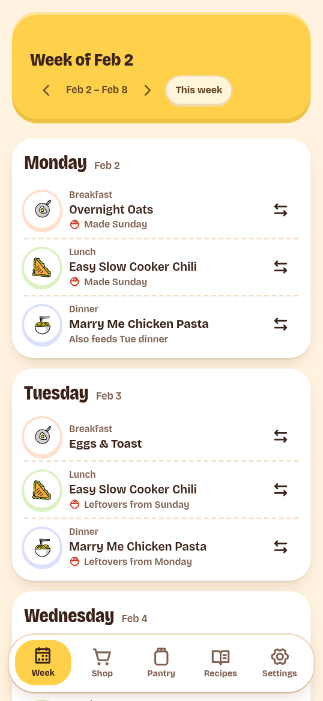

# Meal plans

The Week tab shows the current week of meals. An AI assistant usually creates
the plan. The app shows it, starts cooks, and lets you change one meal at a time.

## Read the week

The header says **This week** or **Week of Nov 2**. The arrows move back and
forward one week. **This week** returns to the current week. The selected week is
in the page URL, so Back and deep links work.

Each day lists its meals:

- Breakfast, lunch, and dinner always show. An empty one offers **Plan
  something**.
- Snacks and dessert appear only when planned.
- A note can say **Made Sunday**, **Leftovers from Sunday**, or **Also feeds
  Tue dinner**. These come from one cook feeding several meals.
- Today carries a **Today** flag.

On the current week, **Dinner tonight** appears above the days. Its actions
depend on the meal: **Start cooking**, **View recipe**, **Swap**, and **Undo** for
a finished meal.

The next prep task also appears, with its due date and **Done**. It picks the
soonest task due today or later, then the most recently overdue one. The app
cannot add or edit prep tasks.

## Change one meal

Tap the swap button on a meal, or **Plan something** on an empty one. The sheet
lists recipes for that meal type. Use the search field to narrow the list. Each
choice shows its time and how much the pantry covers:

- **Pantry has it all**
- **Pantry has 4 of 6**

If a planned cook feeds other meals too, the app asks for a scope:

| Choice | Result |
| --- | --- |
| **Just this meal** | Only this meal changes. The other meals keep the same cook. |
| **This and its leftovers** | The cook changes, so every meal it feeds changes too. |

If the cook feeds only this meal, the app does not ask. A swap changes the plan,
not the recipe.

A cook that is already done cannot be swapped. Its leftover meals can still be
swapped; each one becomes its own meal.

When a swap changes what must be bought, the app shows **Your plan changed.
Update the shopping list** with an **Update** action. Open [Shopping](shopping.md)
and use **Update the list**.

## Leftovers

One cook can feed more than one meal. The cook night and the later meals point
to the same cook, and the later meals are leftovers.

The week board marks the later meals and names the day of the cook. The swap
scope controls whether only the selected meal changes or every meal fed by the
same cook changes.

## Finish a cook and undo it

Use **Start cooking** on **Dinner tonight**, or open a planned meal and use
**Start cooking** on the recipe. Finishing the cook in
[cook mode](recipes.md#cook-a-recipe) completes the planned meal.

A finished cook shows **Cooked** and an undo button. Undo restores the pantry
stock the cook used and returns the meal to **planned**. The toast says
**Cook undone. Pantry restored.** Leftover meals of a finished cook stay on the
plan; they are still to be eaten.

## Empty weeks and limits

If the current week has no plan, the page offers **Start an empty week**. Empty
meals then let you plan one recipe at a time.

A future week with no plan has a **Plan this week** button, but weekly planning
is not in the app yet. The button shows a **Coming soon** message. Ask the
assistant to create the plan. A past week with no plan says nothing was planned.

The app can change one meal, start a cook, finish it, undo it, and mark prep
tasks done. It cannot:

- Generate a complete weekly plan in one action.
- Add snack or dessert slots.
- Add, move, or delete cook events.
- Change planned servings.
- Mark a meal skipped or add a free-text meal.
- Edit plan notes or prep tasks.

Use the API or MCP for those tasks.

## Through the API or MCP

- Create a plan: `plan_create`.
- Replace meal slots: `plan_set_slots`.
- Swap a meal: `plan_swap_meal`.
- Change cooks, servings, or plan fields: `plan_update`.
- Add, edit, or complete prep tasks: `prep_tasks`.
- Complete, skip, reopen, or undo a cook: `cook_complete`.
- Compare planned demand with stock: `availability`.

See [Common MCP tasks](../connect/tasks.md) and the
[MCP tool reference](../reference/mcp-tools.md).
