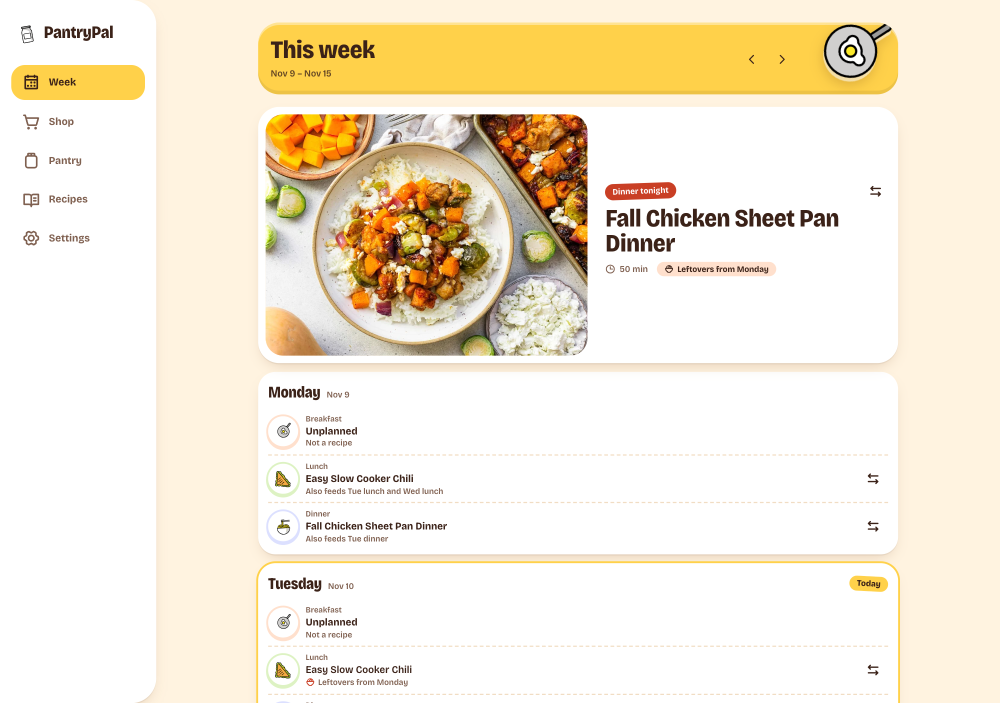

# Meal plans

The Week tab shows the current week of meals. An AI assistant usually creates
the plan. The app shows it, starts cooks, and lets you change one meal at a time.

## Read the week

The header says **This week** or **Week of Nov 2**, with the date range below.
The arrows beside the title move back and forward one week. **This week** returns
to the current week. The selected week is in the page URL, so Back and deep
links work.

Each day lists its meals:

- Breakfast, lunch, and dinner always show. An empty one offers **Plan
  something**.
- Snacks and dessert appear only when planned.
- A meal can hold more than one dish, for example a protein and a side. The
  first dish shows the meal name; each other dish shows **With**.
- A note can say **Made Sunday**, **Leftovers from Sunday**, or **Also feeds
  Tue dinner**. These come from one cook feeding several meals.
- Today carries a **Today** flag.

On the current week, **Dinner tonight** appears above the days. Tap the card to
open the recipe. **Start cooking** shows when the meal is still planned. **Undo**
shows for a finished meal. The swap button sits next to **Dinner tonight** at the
top of the card.
When dinner has more than one dish, the card shows the first one and names the
others under its title.

The next prep task also appears, with its due date and **Done**. It picks the
soonest task due today or later, then the most recently overdue one. The app
cannot add or edit prep tasks.

## Weekly missions and the Treat Stamp

The current week has a **This week's missions** card for planned home-cooked
dinners, trying a recipe not cooked before the week started, and finishing
planned prep. Progress comes from the current plan and completed-cook history;
missions without anything planned are left out. A gentle nudge appears when
more planned dinners remain than nights left, with no penalty for an unfinished
mission.

Finishing all planned home-cooked dinners earns the **Treat Stamp**. **Use my
treat** marks it as enjoyed; this is only a cosmetic reminder, not a reward
that changes the plan or pantry. Its used state is stored in this browser's
local storage, so it does not sync to another browser or device. **Sticker
book** opens the recipe collection.

## Change one meal

Tap the swap button on a meal, or **Plan something** on an empty one. A meal
without a recipe opens the sheet when you tap the row. The sheet
lists recipes for that meal type. Use the search field to narrow the list. Each
choice shows its time and how much the pantry covers:

- **Pantry has it all**
- **Pantry has 4 of 6**

If a planned cook feeds other meals too, the app asks for a scope:

| Choice | Result |
| --- | --- |
| **Just this meal** | Only this meal changes. The other meals keep the same cook. |
| **This and its leftovers** | The cook changes, so every meal it feeds changes too. |

If the cook feeds only this meal, the app does not ask. A swap changes the plan,
not the recipe.

A cook that is already done cannot be swapped. Its leftover meals can still be
swapped; each one becomes its own meal.

When a swap, an added dish, or a removed dish changes what must be bought, the
app shows **Your plan changed.
Update the shopping list** with an **Update** action. Open [Shopping](shopping.md)
and use **Update the list**.

## Add a side to a meal

1. Tap the add button (**+**) on the meal's last dish.
2. Pick a recipe. The sheet lists recipes for that meal type.

The recipe becomes one more dish on the meal, with its own cook. It cooks the
household's default servings for that meal. The other dishes do not change.
Swap each dish on its own with its swap button.

To take a dish off a meal that has more than one, tap its remove button (trash).
The app also removes the dish's planned cook when no other meal eats from it.
You cannot remove a dish that is already cooked; undo the cook first.

A skipped meal has no add button. Swap it to plan a recipe.

## Leftovers

One cook can feed more than one meal. The cook night and the later meals point
to the same cook, and the later meals are leftovers.

The week board marks the later meals and names the day of the cook. The swap
scope controls whether only the selected meal changes or every meal fed by the
same cook changes.

## Finish a cook and undo it

Use **Start cooking** on **Dinner tonight**, or open a planned meal and use
**Start cooking** on the recipe. Finishing the cook in
[cook mode](recipes.md#cook-a-recipe) completes the planned meal.

A finished cook shows **Cooked** and an undo button. Undo restores the pantry
stock the cook used and returns the meal to **planned**. The toast says
**Cook undone. Pantry restored.** Leftover meals of a finished cook stay on the
plan; they are still to be eaten.

## Empty weeks and limits

If the current week has no plan, the page offers **Start an empty week**. Empty
meals then let you plan one recipe at a time, and add more dishes to a meal.

A future week with no plan has a **Plan this week** button, but weekly planning
is not in the app yet. The button shows a **Coming soon** message. Ask the
assistant to create the plan. A past week with no plan says nothing was planned.

The app can change one meal, add or remove a dish, start a cook, finish it, undo
it, and mark prep tasks done. It cannot:

- Generate a complete weekly plan in one action.
- Add snack or dessert slots.
- Move cook events, or add or delete them other than by adding or removing a
  dish.
- Change planned servings.
- Mark a meal skipped or add a free-text meal.
- Edit plan notes or prep tasks.

Use the API or MCP for those tasks.

## Through the API or MCP

- Create a plan: `plan_create`.
- Replace meal slots: `plan_set_slots`. Pass an array of specs to put several
  dishes on one meal.
- Swap a meal: `plan_swap_meal`.
- Add or remove one dish: `plan_dishes`.
- Change cooks, servings, or plan fields: `plan_update`.
- Add, edit, or complete prep tasks: `prep_tasks`.
- Complete, skip, reopen, or undo a cook: `cook_complete`.
- Compare planned demand with stock: `availability`.

See [Common MCP tasks](../connect/tasks.md) and the
[MCP tool reference](../reference/mcp-tools.md).
