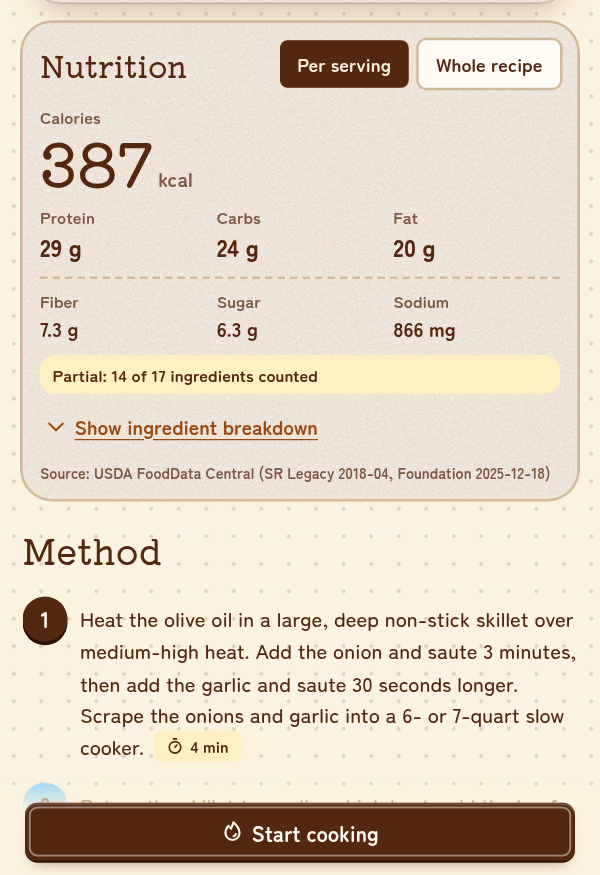

# Nutrition

Each recipe page has a **Nutrition** panel. It shows calories, protein, carbs,
fat, fiber, sugar, and sodium. PantryPal adds up the ingredient lines of the
recipe. It does not guess: a line it cannot calculate stays blank.

## Read the panel

- **Per serving** is the default. **Whole recipe** shows the total for the
  recipe as written. The servings stepper does not change either number.
- Calories are in kcal. Sodium is in mg. The other nutrients are in grams.
- A dash means the data has no value for that nutrient.
- **Partial: 14 of 17 ingredients counted** appears when some lines are blank.
  The totals cover only the counted lines, so the true values are higher.
  Optional ingredients are never counted and are not part of this number.
- **Show ingredient breakdown** opens one row for each ingredient. A row shows
  the grams used, the calories, and the matched USDA food.

## Why a line is blank

| Row text | Meaning | What to do |
| --- | --- | --- |
| **No matching food** | The ingredient has no USDA food. | Choose a food. See [Change a food match](#change-a-food-match). |
| **No amount, not counted** | The recipe line has no quantity, such as "salt, to taste". | Nothing. PantryPal does not guess an amount. |
| **Can't convert cup to grams** | The unit has no known gram weight for this ingredient. | Choose a food that has a portion for the unit. Or add a custom unit conversion through the API or MCP. |
| **Optional, not counted** | The line is marked optional. | Nothing. |

A quantity range, such as 1–2 cloves, uses the middle of the range.

## Change a food match

PantryPal matches each ingredient to a USDA food by name when you add it or
rename it. The match is automatic and can be wrong.

1. Open the recipe and tap **Show ingredient breakdown**.
2. Tap **Change match** on the ingredient. The button reads **Find match** when
   the ingredient has no food.
3. Search by name. Each result shows its calories for 100 g. Tap a food to use it.

The same sheet has two more choices:

- **No match** leaves the ingredient out of the totals. PantryPal does not
  match it again by itself.
- **Auto match** runs the name match again and replaces your choice.

The match belongs to the ingredient, not the recipe. A change applies to every
recipe that uses the ingredient. Renaming an ingredient runs the automatic
match again, unless you chose the food yourself.

## Data source

The data comes from [USDA FoodData Central](https://fdc.nal.usda.gov/): SR Legacy
and Foundation Foods. It is public domain (CC0). The data file is part of
PantryPal, so nutrition works offline and sends nothing to USDA. The panel names
the dataset versions.

Values are estimates for raw or standard foods. Brands, cooking losses, and
your own measuring change the real numbers.

A recipe can also store a hand-entered `nutrition` estimate (see
[Import format](../reference/import-format.md)). The panel does not use it.

## Through the API or MCP

An API client or AI assistant can read nutrition and set matches too:

- Read a recipe: `GET /recipes/{idOrSlug}/nutrition` or `get_recipe_nutrition`.
- Search foods: `GET /nutrition/foods` or `search_foods`.
- Set or clear a match, or run the automatic match:
  `PUT /ingredients/{id}/nutrition` or `set_ingredient_nutrition`.

See the [REST API](../reference/rest-api.md#recipe-nutrition) and the
[MCP tool reference](../reference/mcp-tools.md#nutrition).
