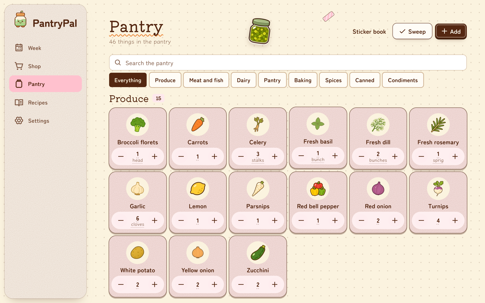

# Pantry

The Pantry tab shows what you have at home. Each row is one ingredient. Rows are
grouped by ingredient category, in the same order as the shopping list, and
sorted by name.

## Find stock

Use **Search the pantry** to filter by name. The chips under the search box
filter by category. **Everything** shows all categories; the other chips appear
only when that category has stock.

## Add stock

Tap **Add** in the header. If the pantry is empty, tap **Add** in the middle of
the screen. Then fill in:

- **What is it?**: a search box. Choose an ingredient from the list. See
  [Ingredients](ingredients.md#choose-an-ingredient). If you typed in **Search
  the pantry** first, the box starts with that text.
- **How much? (optional)**
- **Unit**: a list of the units of that ingredient. It is empty until you choose
  an ingredient. Type a unit that is not in the list to add a measure for it. See
  [Units and measures](units.md#choose-a-unit).

The sheet does not make an ingredient from a typed name. To add food that is
not in your ingredients, choose a USDA food under **USDA foods**, or choose
**Create custom…**. You pick the shopping aisle for the new ingredient there.
The aisle is the ingredient category. It groups pantry rows and shopping items.
To change the aisle of an ingredient you already have, use **Category** in the
row's amount sheet, or **Aisle** on the [ingredient page](ingredients.md#the-ingredient-page).

With an amount, the app adds to the stock already recorded for that ingredient.
The app converts the amount into the ingredient's [stock unit](units.md#stock-unit-and-measures).
The first amount you add sets the stock unit.
Without an amount, the app records the item as **On hand** and leaves the
quantity unknown. If the ingredient is already in the pantry and you give no
amount, the sheet says so and does not add a second row.

## Change an amount

A measured row has **−** and **+** buttons. One tap changes the amount by:

| Unit | Step |
| --- | --- |
| `lb`, `kg`, `l`, `cup`, `gallon` | 0.5 |
| `g`, `ml` | 50 |
| Any other unit, or no unit | 1 |

The amount cannot go below zero. Tap the amount or the row name to open a sheet
and type an exact amount. Choose the **Unit** of the amount. It can be any unit
that the ingredient converts. A row is always stored in the stock unit, so "3
cups" of Baby Spinach with an `oz` stock unit is saved as ounces. Tap **Save**.

If the unit is not known, or has no weight, the sheet stays open. It says which
unit failed and shows **Add a measure for** that unit. See
[When a unit is not known](units.md#when-a-unit-is-not-known).

The same sheet shows **Category**, **Best before**, and **Shelf life in days**.
Change any value, then tap **Save**. Change **Category** to move the ingredient to
another group. Clear **Best before** to remove the date. Clear **Shelf life in
days** to stop dating future purchases of this ingredient.

The sheet also has **Change icon** and **Ingredient page**. **Ingredient page**
opens the [ingredient page](ingredients.md#the-ingredient-page), where you can
change the name, the USDA food, and more.

A row with an expiry date shows **Best before**. An item that expires in three
days or less gets an **Expiring soon** badge. An item past its date gets an
**Expired** badge. Tap **Add to list** on either row to add the ingredient to
this week's list, the newest open list, or a new list.

When a shopping trip completes, each received ingredient gets a purchase date of
today. If the ingredient has a shelf life, the app sets its expiry date to today
plus that number of days.

An unmeasured row shows a status pill: **On hand**, **Running low**, or
**Out**. Tap the pill to change it. **Not sure** can also appear when another
client set an unknown status; the app does not offer it.

For measured items, the server sets the status:

- Zero is **Out**.
- At or below the ingredient's par level is **Running low**.
- Anything else is **On hand**.

## Exact, approximate, and unknown amounts

| State | How it is set |
| --- | --- |
| Exact | Enter an amount in the app or send `qty` and `unit` through the API or MCP. |
| Approximate | Set `qtyApprox: true` through the API or MCP. The app has no control for this flag. |
| Unknown | Add an item without an amount, or send `qty: null`. |

An unknown amount is not zero. The recipe page does not count it as missing.
A shopping list adds a **check the pantry** note instead of assuming the item is
missing, unless the item is marked **Running low** or **Out**. In that case the
list gets the full amount the plan needs.

The app records exact amounts. It shows an approximate amount as a normal
number, without an estimate marker.

## Sweep the pantry

A sweep is a relaxed check of your stock. It has no time limit. Tap **Sweep**
in the header. The header shows **Sweep** only when the pantry has items.

The sweep shows one item at a time with its icon, name, and amount. The order
is random. It changes each time you open the sweep. The sweep covers every item,
with or without an amount, except items that a recent sweep already covered
(see [Items you answered are left out for a while](#items-you-answered-are-left-out-for-a-while)).
A line such as "4 of 38" and a thin progress bar show where you are. Choose one
answer:

| Answer | Key | What it does |
| --- | --- | --- |
| **Still have it** | `1` or Right arrow | Marks the item as checked today. The amount does not change. |
| **Running low** | `2` or Left arrow | Sets the status to **Running low** and adds the item to the list. The amount does not change. |
| **All out** | `3` or Down arrow | Sets the item to **Out** and adds it to the list. A measured item goes to zero. |
| **Skip** | `S` or Up arrow | Moves on. Nothing changes. |

You can also drag the item card. Drag it right for **Still have it** and left
for **Running low**. The card follows your finger or mouse and tilts a little.
A label with an icon fades in as you drag. At 80 pixels the label turns solid
and the edge of the card shows a color. Let go past that point to answer. Let go
before it, and the card goes back. If your device is set to reduce motion, the
card does not tilt or fly off, but the label and the color still show. The list
is the same one **Add to list** uses: this week's list, the newest open list,
or a new list.

The app saves each answer at once. Tap **Finish** at any time to end the sweep
and see the summary. The sweep also ends when you answer every item. The summary
looks like this: "Swept 4 things. 2 went on your shopping list." Skipped items
are not counted. Tap **Done** to close it. You can close the sweep early with
**Esc** or **Close**. The answers you gave stay saved.

### Undo an answer

Tap **Undo** or press `U` to go back to the previous item. You can do this again
and again, back to the first item. **Undo** is off until you have answered an
item. Undo:

- puts the item's status and amount back as they were;
- takes the item off the shopping list if the answer added it there;
- removes the item from the "left out for a while" list and from the count of
  swept things.

After **Still have it**, undo keeps the "checked today" mark. It does not change
the amount. You cannot undo from the summary.

### Items you answered are left out for a while

After you answer an item, later sweeps leave it out:

| Answer | Left out for |
| --- | --- |
| **Running low** or **All out** | 7 days |
| **Still have it** | 3 days |
| **Skip** | Not at all |

The app keeps this in this browser's local storage, so another browser or device
does not share it. If a sweep finds nothing to check, it shows "Everything was
checked lately. Nice and tidy!". Tap **Sweep everything anyway** to sweep all
items now.

A finished sweep that has at least one answer counts for the **Sweep the
pantry** mission on the week screen. This also applies when you end the sweep
with **Finish**. The app stores that count in this browser's local storage. See
[Weekly missions](meal-plans.md#weekly-missions-and-the-treat-stamp).

## Ingredients and Needs attention

Tap **Ingredients** in the header to open the
[ingredient list](ingredients.md#the-ingredient-list). When some ingredients have
no USDA food, an odd name, or an unchecked custom entry, the header also shows
**Needs attention** with a count. Tap it to see them. See
[Needs attention](ingredients.md#needs-attention).

## Open the sticker book

Tap **Sticker book** in the header to open the
[ingredient sticker book](ingredient-dex.md). The Pantry tab stays highlighted
while you view it.

## Remove stock

Open the item's amount sheet, tap **Remove from pantry**, then confirm with
**Remove**. The toast offers **Undo**. Undo puts the row back with its amount. It
does not restore the row's past stock movements.

## Through the API or MCP

These tasks have no web screen:

- Mark stock as checked: `pantry_update` with `action: "verify"`.
- Add notes, purchase dates, or open dates.
- Read stock history: `pantry_history`.
- Set ingredient aliases, par levels (`parQty`), stock units (`stockUnit`), or
  categories (`ingredient_upsert` with `action: "update"`). The ingredient page
  sets the stock unit and the minimum, and the web item sheet changes the
  category for you.
- Set measures: `ingredient_measures`. See [Units and measures](units.md).
- Create an ingredient from a USDA food with `fdcId`, or a custom one with
  `create_custom_ingredient`. The pantry tools do not create ingredients from a
  name. See [Ingredients](ingredients.md#through-the-api-or-mcp).

See [Common MCP tasks](../connect/tasks.md) and the
[MCP tool reference](../reference/mcp-tools.md). The REST endpoints are in the
[REST API reference](../reference/rest-api.md).
