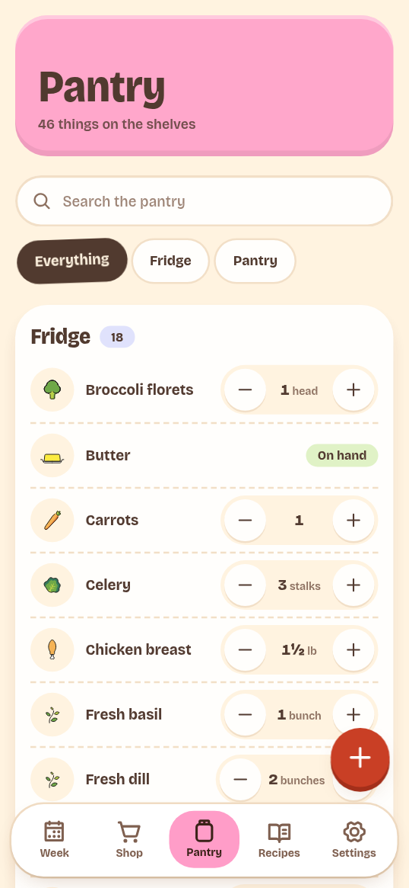

# Pantry

The Pantry tab shows what you have at home. Each row is one ingredient in one
storage location: Fridge, Pantry, Freezer, Counter, or Other. Rows are grouped
by shelf and sorted by name.

## Find stock

Use **Search the pantry** to filter by name. The chips under the search box
filter by shelf. **Everything** shows all shelves; the other chips appear only
when that shelf has stock.

## Add stock

Tap the **+** button. If the pantry is empty, tap **Add**. Then fill in:

- **What is it?**
- **How much? (optional)**
- **Unit**
- **Where does it live?**
- **Shopping aisle**

The aisle is used when the app creates an ingredient. Shopping lists group items
by ingredient category.

With an amount, the app adds to the stock already on that shelf. A new name
creates a new ingredient. Without an amount, the app records the item as
**On hand** and leaves the quantity unknown.

## Change an amount

A measured row has **−** and **+** buttons. One tap changes the amount by:

| Unit | Step |
| --- | --- |
| `lb`, `kg`, `l`, `cup`, `gallon` | 0.5 |
| `g`, `ml` | 50 |
| Any other unit, or no unit | 1 |

The amount cannot go below zero. Tap the amount or the row name to open a sheet
and type an exact amount. Tap **Save**.

An unmeasured row shows a status pill: **On hand**, **Running low**, or
**Out**. Tap the pill to change it. **Not sure** can also appear when another
client set an unknown status; the app does not offer it.

For measured items, the server sets the status:

- Zero is **Out**.
- At or below the ingredient's par level is **Running low**.
- Anything else is **On hand**.

## Exact, approximate, and unknown amounts

| State | How it is set |
| --- | --- |
| Exact | Enter an amount in the app or send `qty` and `unit` through the API or MCP. |
| Approximate | Set `qtyApprox: true` through the API or MCP. The app has no control for this flag. |
| Unknown | Add an item without an amount, or send `qty: null`. |

An unknown amount is not zero. The recipe page does not count it as missing.
A shopping list adds a **check the pantry** note instead of assuming the item
is missing.

The app records exact amounts. It shows an approximate amount as a normal
number, without an estimate marker.

## Remove stock

Open the item's amount sheet, tap **Remove from pantry**, then confirm with
**Remove**. The toast offers **Undo**. Undo puts the row back with its amount and
shelf. It does not restore the row's past stock movements.

## Through the API or MCP

These tasks have no web screen:

- Move stock to another shelf: `pantry_update` with `action: "move"`.
- Mark stock as checked: `pantry_update` with `action: "verify"`.
- Add notes, purchase dates, open dates, or expiry dates.
- Read stock history: `pantry_history`.
- Set ingredient aliases, par levels, or default units.

See [Common MCP tasks](../connect/tasks.md) and the
[MCP tool reference](../reference/mcp-tools.md). The REST endpoints are in the
[REST API reference](../reference/rest-api.md).
