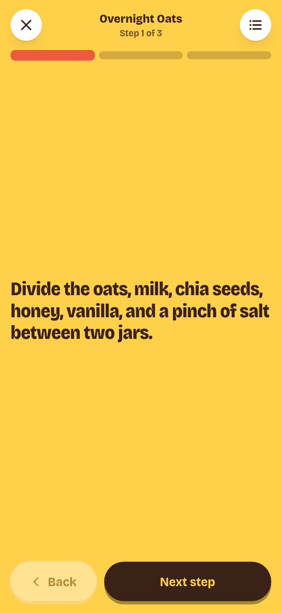

# Recipes

The Recipes tab is the recipe box. Tap a card to read the recipe, change its
servings, or start cooking.

Recipes are created and edited outside the app, by an AI assistant or an API
client. The web app has no recipe editor.

## Browse the box

Cards show the photo, title, total time, and base servings. A recipe that is
still **Want to try** carries a **New to try** tag.

Two status views are available:

| View | Shows |
| --- | --- |
| **Rotation + want to try** | The default. Trusted recipes and new ones. |
| **Never** | Recipes you do not want to cook again. Each has **Move to rotation**. |

The meal chips (**All**, **Breakfast**, **Lunch**, **Dinner**, **Snacks**,
**Dessert**) combine with the status view. **Search recipes** filters by text.
The view, meal, and search are kept in the page URL, so Back and shared links
keep the same list.

**Archived** recipes have no UI. They do not appear in any list and have no
status control.

## Read a recipe

The recipe page shows the photo, time, base yield, tags, and a link to the
original page when the recipe was imported.

Use the servings stepper to change the amount. The server scales the ingredient
amounts; scaling-exempt ingredients and lines without a quantity stay as
written.

Each ingredient shows a pantry mark:

- A check means the pantry has enough.
- **½** means some, but not enough.
- **+** means not in the pantry.
- No mark means the pantry amount is unknown.

**What am I missing?** lists **Need to buy** and **Running short** ingredients.
Optional ingredients are not counted. Unknown amounts are not treated as zero;
check those in the [pantry](pantry.md).

## Set a recipe status

Use **Rotation**, **Want to try**, or **Never** on the recipe page. The change
saves at once. **Never** recipes are hidden from the default box and from the
week's swap picker.

After you cook a **Want to try** recipe, the done screen asks **How was it?**:

- **Cook it again** moves it to **Rotation**.
- **Never again** moves it to **Never**.
- **Not now** leaves the status unchanged.

## Cook a recipe

Tap **Start cooking**. Cook mode shows one step at a time, with a progress bar
and **Back** / **Next step** buttons. Swipe left or right on a phone. On a
keyboard, use the arrow keys.

The list button opens the full ingredient list for the chosen servings. A step
with a duration has a timer button: **Start 10 min timer**, then **Cancel** when
needed. Timers beep and vibrate where the browser allows.

The screen stays awake while you cook when the browser permits it. This needs
HTTPS (or localhost). See [Access and security](../host/security.md).

Cook mode does not change the server until you finish. Your place is saved on
this device. If you leave after the first step, the app offers **Resume at step
N** or **Start over**, and the recipe page shows the same resume link. Timers
are not saved.

### Finish or undo

**Finish cooking** uses the servings shown on screen:

- If you opened cook mode from a planned meal, it completes that cook.
- If you started from the recipe box and the same recipe is planned for today,
  the app asks **Cooking tonight's planned meal?** Choose **Yes, that one** or
  **No, just cooking**.
- Otherwise it records an ad-hoc cook, outside the plan.

The done screen shows how many pantry items were used or reduced. The server
deducts the scaled, non-optional ingredients from the pantry. It never records
more than the stock on hand. A line with no quantity, no stock row, or an
incomparable unit is left unchanged and may appear under **Heads up**. A stock
row with an unknown amount stays unknown.

**Undo** is on the done screen and in the toast. It restores the stock the cook
took out. A planned cook returns to **planned**; an ad-hoc cook is deleted. You
can also undo a finished meal from the week board.

## Through the API or MCP

Use these for work the app cannot do:

- Create or edit a recipe: `recipe_save`.
- Add a rating or a note about a status change: `recipe_set_status`.
- Read status history: `GET /recipes/{idOrSlug}/status-history`.
- Check a recipe against dietary rules: `recipe_check`. See
  [Dietary rules](dietary-rules.md).

See [Common MCP tasks](../connect/tasks.md) and the
[MCP tool reference](../reference/mcp-tools.md).
