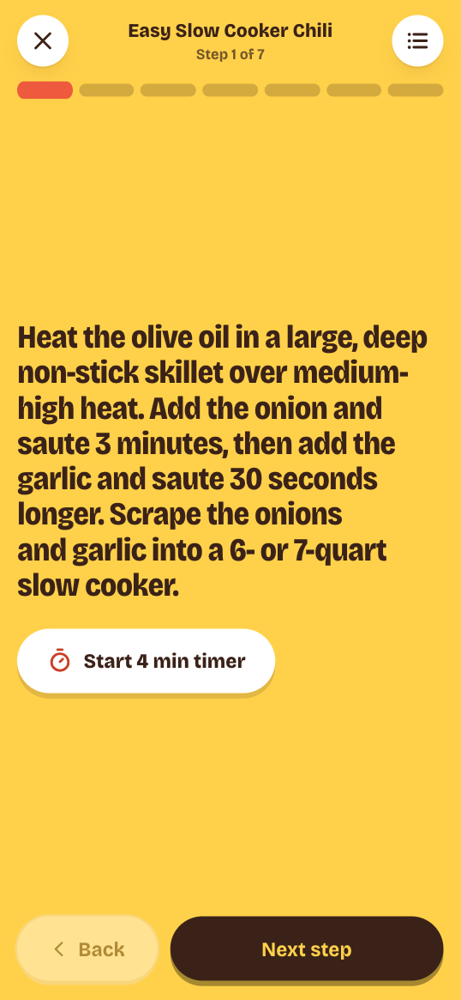

# Recipes

The Recipes tab is the recipe box. Tap a card to read the recipe, change its
servings, or start cooking.

Use **New recipe** on the Recipes tab, or **Edit recipe** on a recipe page, to
create and change recipes in the app. An AI assistant or an API client can also
create and change recipes. See [Create and edit recipes](recipe-editor.md).

## Browse the box

Cards show the photo, title, total time, and base servings. A recipe that is
still **Want to try** carries a **New to try** tag.

Two status views are available:

| View | Shows |
| --- | --- |
| **Rotation + want to try** | The default. Trusted recipes and new ones. |
| **Never** | Recipes you do not want to cook again. Each has **Move to rotation**. |

The meal chips (**All**, **Breakfast**, **Lunch**, **Dinner**, **Snacks**,
**Dessert**) combine with the status view. **Search recipes** filters by text.
The view, meal, and search are kept in the page URL, so Back and shared links
keep the same list.

**Archived** recipes have no UI. They do not appear in any list and have no
status control.

## Read a recipe

The recipe page shows the photo, time, base yield, tags, and a link to the
original page when the recipe was imported.

Use the servings stepper to change the amount. The server scales the ingredient
amounts; scaling-exempt ingredients and lines without a quantity stay as
written.

Each ingredient shows a pantry mark:

- A check means the pantry has enough.
- **½** means some, but not enough.
- **+** means not in the pantry.
- No mark means the pantry amount is unknown.

**What am I missing?** lists **Need to buy** and **Running short** ingredients.
Optional ingredients are not counted. Unknown amounts are not treated as zero;
check those in the [pantry](pantry.md).

## Set a recipe status

Use **Rotation**, **Want to try**, or **Never** in the **Keep in rotation?** row
on the recipe page. **Rotation** and **Want to try** save at once. **Never** asks
first: tap **Never cook it again** to confirm, or **Keep it** to stop. **Never**
recipes are hidden from the default box and from the week's swap picker.

After you cook a **Want to try** recipe, the done screen asks **How was it?**:

- **Cook it again** moves it to **Rotation**.
- **Never again** moves it to **Never**.
- **Not now** leaves the status unchanged.

## Delete or archive a recipe

The recipe page has one of two actions under the status control. Both have a red
outline, because both remove the recipe from your box:

- **Delete recipe** removes the recipe. It shows only when the recipe has no
  cook events. The app asks you to confirm.
- **Archive recipe** shows when the recipe has cook events. Archive moves the
  recipe to the **archived** status and keeps its cook history. An archived
  recipe does not show in any list.

The API refuses `DELETE /recipes/{idOrSlug}` with a conflict when cook events
reference the recipe. Use the **archived** status in that case.

## Cook a recipe

Tap **Start cooking**. Cook mode shows one step at a time, with a progress bar
and **Back** / **Next step** buttons. Swipe left or right on a phone. On a
keyboard, use the arrow keys.

The list button opens the full ingredient list for the chosen servings. A step
with a duration has a timer button: **Start 10 min timer**, then **Cancel** when
needed. Timers beep and vibrate where the browser allows.

A step that has ingredient links shows them as pills under the instruction. A
pill has the ingredient name, the amount in the chosen servings, and the prep
note. See [Create and edit recipes](recipe-editor.md).

The screen stays awake while you cook when the browser permits it. This needs
HTTPS (or localhost). See [Access and security](../host/security.md).

Cook mode does not change the server until you finish. Your place is saved on
this device. If you leave after the first step, the app offers **Resume at step
N** or **Start over**, and the recipe page shows the same resume link. Timers
are not saved.

### Cook together

Two to four people can split one recipe. Each cook follows only their own
steps. This works best on a shared tablet in landscape.

1. Add each person in **Settings** > **People**.
2. Open cook mode. When the household has two or more people, **Who's cooking?**
   opens by itself. Select two to four people, then tap **Next**. To cook alone,
   tap **Just me** or close the sheet. To change cooks later, tap **Cooks**.
3. Under **Assign steps**, tap a name on each step to give that step to that
   cook. Tap a name on a group heading, such as "Sauce", to give the whole group
   to that cook. The app starts with groups shared out in turn.
4. Tap **Start cooking**.

The screen shows one panel per cook: two side by side, or a 2 × 2 grid for three
or four cooks. On a narrow screen, the panels stack. Each panel has its own
**Back** and **Next** buttons. After a cook's last step, **Done** ends that
cook's part. Swipe and arrow keys do not move steps in this view.

Timers stay in each cook's step, as in single-cook mode. Alerts show at the top
with the cook's name. A running timer also shows at the top when no panel shows
its step, for example after that cook moved on. Tap it to move that cook back to
that step.

**Finish cooking** appears when every cook is done. To go back to one cook, tap
**Cooks**, then **Just me**.

The cooks and their places are saved on this device with the rest of your
progress. When you come back, the app shows **Resume** instead of a step number.
Each person cannot yet follow along on their own phone.

### Finish or undo

**Finish cooking** uses the servings shown on screen:

- If you opened cook mode from a planned meal, it completes that cook.
- If you started from the recipe box and the same recipe is planned for today,
  the app asks **Cooking tonight's planned meal?** Choose **Yes, that one** or
  **No, just cooking**.
- Otherwise it records an ad-hoc cook, outside the plan.

The done screen shows how many pantry items were used or reduced. The server
deducts the scaled, non-optional ingredients from the pantry. It never records
more than the stock on hand. A line with no quantity, no stock row, or an
incomparable unit is left unchanged and may appear under **Heads up**. A stock
row with an unknown amount stays unknown.

**Undo** is on the done screen and in the toast. It restores the stock the cook
took out. A planned cook returns to **planned**; an ad-hoc cook is deleted. You
can also undo a finished meal from the Week page.

## Through the API or MCP

Use these for bulk work and automation:

- Create or edit many recipes, or set step ingredient links: `recipe_save`.
- Add a rating or a note about a status change: `recipe_set_status`.
- Read status history: `GET /recipes/{idOrSlug}/status-history`.
- Check a recipe against dietary rules: `recipe_check`. See
  [Dietary rules](dietary-rules.md).

See [Common MCP tasks](../connect/tasks.md) and the
[MCP tool reference](../reference/mcp-tools.md).
