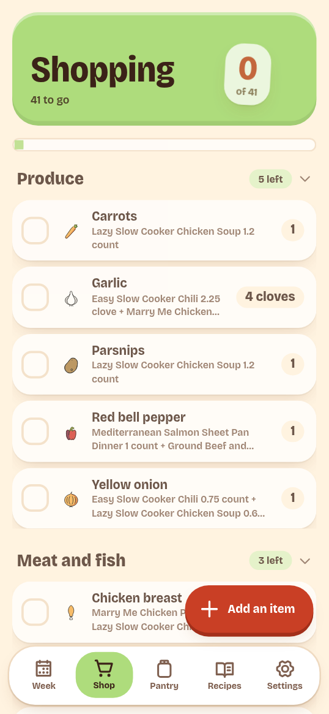

# Shopping

The Shop tab shows a shopping list for the week. It can come from the plan or be
a blank list you fill by hand. Check items off as they go in the cart, then
record what you bought.

## Get a list

The app opens the current week's open plan list when one exists. Otherwise it
opens another open list, or offers:

- **Make the shopping list** when the week has a plan.
- **Start a blank list** when there is no plan.

Use **Switch list** to move between open lists. Finished lists do not appear in
the picker.

A plan list is built from planned meals minus stock on hand. Low or out items
marked as staples are added as **staple restock**. An item whose amount is
unknown, or whose units do not convert, gets a **check the pantry** note instead
of a guessed amount.

A blank list is not linked to a plan. It has no update banner and no regenerate
control.

## Shop

Items are grouped by aisle, such as **Produce**, **Meat and fish**, and
**Dairy**. The header shows how many are left, and the bar shows progress. Tap a
row to check it off; tap again to clear the check.

Most items show why they are there, for example the planned recipe and its
amount. An item added by hand says **Added by hand**.

Tap **Add an item**, type a name, and tap **Add**. The app matches the name to an
ingredient when it can. A name with no match stays as free text and is skipped
when you finish the list.

### When the plan changes

If the plan changes what must be bought, a banner says **Your plan changed.**
**Update the list to match.** Tap **Update the list**. The app replaces generated
items that are not checked yet. Items you added and items already checked stay.

### Clear the list

**Clear list** removes every item, checked or not, from the plan or added by
hand. It does not change the pantry. Confirm with **Clear list**; **Keep the
list** cancels. Add items again by hand, or ask the assistant to regenerate the
list.

## Finish the trip

Tap **Done shopping**, then **Add to pantry**. The app asks you to check what you
actually got. Edit a quantity if it differs from the plan. An item that is not
tracked in the pantry shows **Skipped**.

**Add to pantry** is disabled until at least one item is checked. Checked items
become pantry purchase movements, and the list closes as done. The result screen
says **Shopping done!** and links to **See the pantry**.

Items left unchecked stay on the finished list and do not carry over to the next
one. The app has no undo for finishing a list. If an amount is wrong, correct it
on the [Pantry](pantry.md) tab.

## Through the API or MCP

The app covers the normal trip. These tasks are API or MCP only:

- Choose whether list generation includes staples: `shopping_generate`.
- Substitute an ingredient, edit an item, or check items with actual amounts:
  `shopping_update`.
- Complete a list with received quantities, or without writing stock:
  `shopping_complete`.
- Change a list's title or notes.

See [Common MCP tasks](../connect/tasks.md) and the
[MCP tool reference](../reference/mcp-tools.md).
