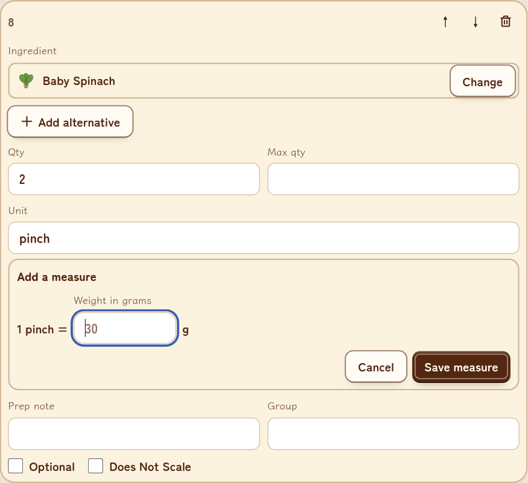
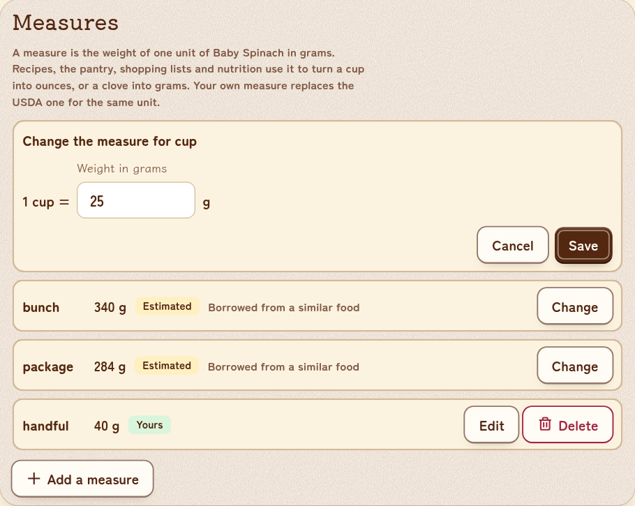

# Units and measures

A recipe says "3 cups" of spinach. The pantry holds "5 oz". Nutrition needs grams.
Rakumi turns one unit into another with one converter. The pantry, recipes,
shopping lists, cooking, and nutrition all use it. This page explains the two
things you control: the stock unit and the measures of an ingredient.

## Stock unit and measures

| Term | Meaning |
| --- | --- |
| **Stock unit** | The one unit an ingredient is stored in. Pantry amounts, the **Keep at least** minimum, and shopping amounts use it. |
| **Measure** | The weight in grams of one unit of an ingredient, for example 1 cup of Baby Spinach is 30 g. |

Every ingredient has at most one stock unit. You can type an amount in any unit
that the ingredient converts. Rakumi converts it into the stock unit before it
saves it. The movement history keeps the amount and unit you entered.

An ingredient with no stock unit gets one from its first pantry entry. If you add
"5 oz", the stock unit is `oz`.

Some units convert with no measure:

- Mass units: `g`, `kg`, `oz`, `lb`.
- Volume units: `ml`, `l`, `tsp`, `tbsp`, `fl oz`, `cup`, `pint`, `quart`, `gallon`.
- Count units, and the sizes `small`, `medium`, `large`, `extra-large`, and `jumbo`.

A volume unit and a mass unit need a measure. For example, a cup of spinach has no
fixed weight. One measure in a volume unit, such as 1 cup = 30 g, sets the weight
for every volume unit of that ingredient. A unit that is not a mass, volume, or
count unit, such as `handful`, `can`, `bunch`, or `clove`, needs its own measure.

## Where the measures come from

Rakumi gives each ingredient measures from three sources. The **Measures**
section of the [ingredient page](ingredients.md#the-ingredient-page) shows them.

| Badge | Source |
| --- | --- |
| **USDA** | A portion of the USDA food that the ingredient links to. |
| **Estimated** | A portion that Rakumi borrowed from a similar USDA food. See [Estimated sizes](#estimated-usda-sizes). |
| **Yours** | A measure that you set. It replaces the USDA measure for the same unit. |

The USDA measures follow the linked food. If you link another food, the USDA and
estimated measures change with it. Your own measures stay.

## Choose a unit

Wherever you type a unit for an ingredient, the **Unit** box is a list. Tap the
box to see the units of that ingredient: the stock unit first, then its measures
with their weight, then the common units. A measure shows its weight under the
unit, for example `30 g (estimated)`.

You find the **Unit** box in these places:

- The **Unit** box of a recipe line. It appears after you choose an ingredient.
- **Unit** in the pantry **Add** sheet and in the pantry amount sheet.
- **Unit** in the shopping item sheet, for an item that has an ingredient. An item
  with free text only has no ingredient, so it has no **Unit** list.
- **Stock unit** on the ingredient page.

Type to narrow the list. With a keyboard, press the Down and Up arrow keys to
move, **Enter** to choose, and **Esc** to close the list. "cups" and "tablespoon"
are accepted: Rakumi changes them to `cup` and `tbsp`.

## Add a measure for a new unit

Type a unit that the ingredient does not have, for example `handful`. The list
shows **Add a measure: 1 handful = ? g**.

1. Choose **Add a measure: 1 handful = ? g**.
2. In **Weight in grams**, enter the weight of one handful, for example `25`.
3. Tap **Save measure**.

The unit is now valid for this ingredient, and the box selects it. The measure
shows under **Measures** on the ingredient page with the **Yours** badge. Tap
**Cancel** to leave the form without a measure.

A mass unit (`g`, `kg`, `oz`, `lb`) cannot get a measure, because its weight is
fixed. The form shows the reason.

## The Measures section

Open an ingredient to see **Measures**. Each row shows the unit, its weight, and
the badge.

| Button | What it does |
| --- | --- |
| **Change** | Shown on a **USDA** or **Estimated** row. It opens the weight in a form. Your new value becomes a **Yours** measure and replaces the USDA one. |
| **Edit** | Shown on a **Yours** row. It changes the weight. |
| **Reset to USDA** | Shown on a **Yours** row that replaces a USDA measure. It deletes your measure. The USDA weight is back. |
| **Delete** | Shown on a **Yours** row with no USDA measure. It asks first. The unit stops converting until you add the measure again. |
| **Add a measure** | Opens a form with **Unit** and **Weight in grams** for a new unit. |

A change shows at once in the nutrition of every recipe that uses the ingredient.
For example, set 1 cup of Baby Spinach to 25 g, and a recipe with 3 cups counts
75 g. Tap **Reset to USDA**, and it counts 90 g again.

## The stock unit

**Stock unit** is under **Details** on the ingredient page. The note under it says
that pantry amounts and the minimum use this unit. **Keep at least** shows the
unit next to its name.

To change the stock unit, choose a unit and tap **Save changes**. Rakumi
converts the pantry amount and the minimum into the new unit. If it cannot, it
changes nothing and tells you which unit has no weight. The message has buttons:

- **Use** a unit: puts a unit that works in the box.
- **Add a measure for** the unit: opens the measure form.

Add the measure, then tap **Save changes** again.

## When a unit is not known

A recipe line, a pantry amount, or a shopping item can have a unit that the
ingredient does not accept, for example `pinch`. The app does not save it. A
message under the box says which unit failed. It lists the units that work, and
shows **Add a measure for** the unit. Pick one of them, or add the measure.

When you save a recipe, the message appears above **Save recipe**. The recipe is
not saved until every unit is valid. Nothing is saved in part.

A unit can be valid but have no weight. For example, a recipe line "2 cups" of an
ingredient with no volume measure and no linked food. Rakumi keeps the line
and marks it. See [Why a line is blank](nutrition.md#why-a-line-is-blank). The
ingredient shows **Unit has no weight** under **Needs attention**.

## Estimated USDA sizes

The bundled USDA data lists no portions for most Foundation foods. For these
foods, Rakumi borrows the portions of the closest SR Legacy food: the same food
in the same form, such as raw or canned. It marks the portions as **Estimated**.

Treat an estimated weight as a good guess. A cup of baby spinach is about 30 g.
Your packages can differ. Tap **Change** on the row to set your own weight.

A food with no close match has no portions. The ingredient then needs measures
from you.

## Through the API or MCP

These tasks work through the API or MCP:

- List, set, and delete measures: `GET`, `PUT`, and `DELETE` on
  `/ingredients/{id}/measures`, or the `ingredient_measures` tool. See the
  [REST API](../reference/rest-api.md#units-and-measures) and the
  [MCP tool reference](../reference/mcp-tools.md#ingredients-and-units).
- Convert an amount: `POST /units/convert`.
- Set the stock unit with `stockUnit` on `PATCH /ingredients/{id}`.

A write with a unit that the ingredient does not accept returns `unprocessable`
(422) with `details.unresolvedUnits`. Each entry has suggestions and a hint. Add
the measure, then send the request again.
