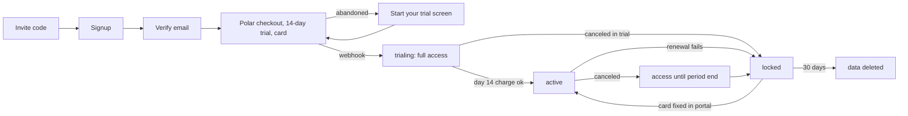

# Hosted version: billing and email plan (draft)

Status: planning only. Nothing here is built. Do not describe it in `docs/` until it ships.

Principle: Polar owns billing (trial, charges, retries, reminders, invoices, cancel). PantryPal keeps a
copy of Polar's subscription state, written only by webhooks, and enforces access.

## Decisions

| Topic | Decision |
|---|---|
| Payment provider | Polar (merchant of record: Polar files VAT and sales tax) |
| Price | $3.99/month or $39/year, per household. Can change later |
| Trial | 14 days in Polar. Card collected at checkout; Polar charges at day 14 |
| Trial reminders | Polar emails 3 days before the trial ends |
| Trial abuse | Polar "Prevent trial abuse" setting on (email + card fingerprint) |
| Failed renewal | Lock immediately (Polar grace period: "Immediately"). Polar retries at 2, 7, 14, 21 days, then cancels |
| Lapse | Account locks. Locked users can sign in, but see only a screen that links to checkout or the Polar portal |
| API tokens and MCP | Blocked while locked, not revoked |
| Retention | Delete household data 30 days after the lock |
| Refunds | On request within 7 days of the first charge only |
| Signup | Invite codes from the waitlist |
| Code location | This repo. Hosted features (billing, email, invites) are off by default; self-hosters see nothing |
| Hosted-only docs | One operator page, separate from the self-host guides |
| Email provider | Resend free plan (3,000/mo, 100/day, 30-day logs), sent over SMTP so the provider can change |
| Email format | Plain text plus simple HTML in Kitchen Diary colors |
| Seller | Sole proprietor |
| Markets | Worldwide, English only. Translations later (backlog) |

## Today's starting point

- `account` 1:1 `household`; email + password; signup switch `PANTRYPAL_SIGNUP=open|closed`.
- All tenants share one SQLite file.
- No email sending, no email verification.
- Three ways in: session cookie (web), API token, MCP. Billing must gate all three.

## Flow

## Access by Polar status

| Polar status | Access |
|---|---|
| `trialing`, `active` | Full |
| `active` with cancel at period end | Full until period end, plus a "Resume" link |
| `past_due`, `canceled` (period over), `revoked`, or no subscription | Locked |

Locked: sign in, billing screens, sign out. Everything else (web API, API tokens, MCP) returns
`402 subscription_required`.

## Endpoints (planned)

- `POST /billing/checkout {interval}`: create a Polar checkout session (`external_customer_id` = household id); return its URL.
- `GET /billing/portal`: return a Polar customer portal URL (card, cancel, invoices).
- `GET /billing/status`: state for the web app (banner, lock screen).
- `POST /billing/webhook`: verify signature, ignore duplicate event ids, update the local copy.

## Data (new tables)

- `subscription`: `household_id` (PK), `polar_customer_id`, `polar_subscription_id`, `status`, `interval`, `current_period_end`, `cancel_at_period_end`, `locked_at`, `updated_at`.
- `billing_event`: Polar event id (unique), type, received at.
- `invite_code`: code, created at, used by account, used at.

## Daily job (PantryPal)

- Delete households locked for 30 days. Warn by email on day 23 and day 29.
- Nothing else: trial end, retries, and reminders are Polar's.

## Configuration (planned)

| Variable | Purpose |
|---|---|
| `PANTRYPAL_BILLING` | `off` (default) or `polar` |
| `PANTRYPAL_SIGNUP` | add `invite` beside `open` and `closed` |
| `POLAR_ACCESS_TOKEN`, `POLAR_WEBHOOK_SECRET` | Polar API and webhook signing |
| `POLAR_PRODUCT_MONTHLY`, `POLAR_PRODUCT_YEARLY` | Product ids (trial set on the product) |
| `PANTRYPAL_SMTP_HOST`, `_PORT`, `_USER`, `_PASSWORD`, `_FROM` | Email sending. Unset = no email (today's behavior: admin resets passwords with the CLI) |

## Email

| Email | Sender | When |
|---|---|---|
| Invite | PantryPal | You invite from the waitlist. Send in batches (100/day cap) |
| Verify email | PantryPal | After signup |
| Password reset | PantryPal | On request |
| Deletion warning | PantryPal | Day 23 and day 29 after a lock |
| Receipts, trial reminder, failed payment | Polar | Polar's schedule |

DNS for the sending domain: SPF, DKIM, DMARC. Blocked until a domain is chosen.

## Prerequisites

- Resend account, verified sending domain; email verification and password reset flows.
- Legal pages: terms (30-day deletion, 7-day first-charge refund), privacy, contact address.
- Confirm Polar pays out to a sole proprietor in your country.
- Per-tenant backup and restore.

## Landing page changes

- Mockup says "Cancel any time" under the trial; add that a card is needed for the trial.
- Remove "Export your data any time" (no export planned).

## Open questions

- Polar webhook event names and signature format: confirm when building.
